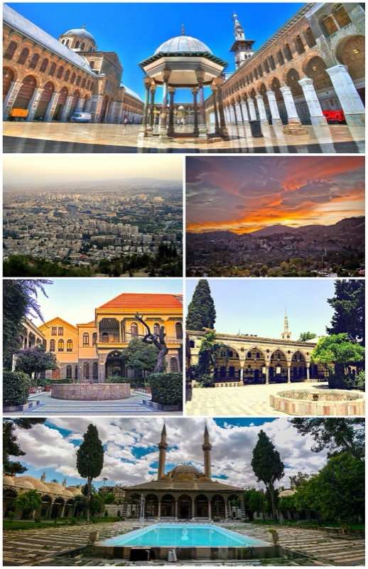

---
id    = "40c77a8e-a9c4-51dc-aa9e-55a908a09216"
model = "Basic"
tags  = ["asia", "mediterranean", "middle_east", "sovereign_state", "capital"]
---

## Front

What is the capital of <b>Syria</b>?

## Back

<b>Damascus</b>

## Extra

<i>Photo: See above., CC BY-SA 3.0, via Wikimedia Commons</i>

About 2.69 million people (2024) 680 m up on a plateau in the Anti-Lebanon foothills, 80 km inland

Described as the oldest capital city in the world, and one of the oldest continuously inhabited. It was chosen as the capital of the Umayyad Caliphate from 661 to 750.

<a href="https://en.wikipedia.org/wiki/Damascus">Damascus on Wikipedia</a> <a href="https://en.wikipedia.org/wiki/Syria">Syria on Wikipedia</a>
