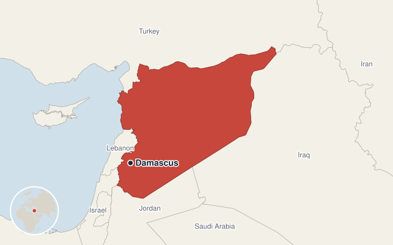

---
id    = "40c77a8e-a9c4-51dc-aa9e-55a908a09216"
model = "Basic"
tags  = ["asia", "mediterranean", "middle_east", "sovereign_state", "capital"]
---

## Front

What is the capital of <b>Syria</b>?

## Back

<b>Damascus</b>

## Extra

<a href="https://en.wikipedia.org/wiki/Damascus">Damascus on Wikipedia</a> <a href="https://en.wikipedia.org/wiki/Syria">Syria on Wikipedia</a>
