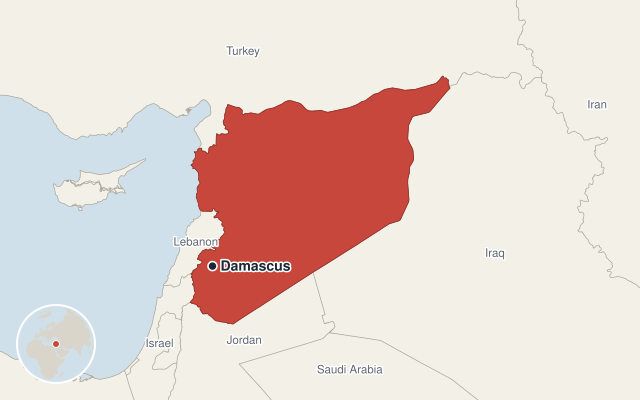
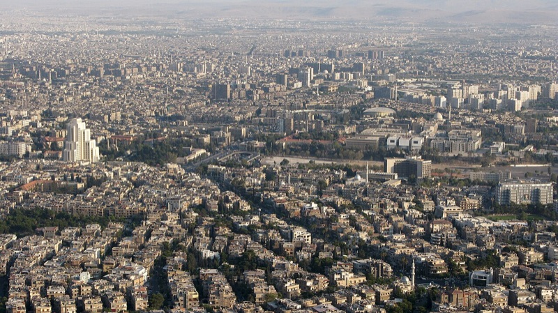

---
id    = "51ffd2d4-387d-59c5-830f-67ae4fabedf3"
model = "Basic"
tags  = ["asia", "mediterranean", "middle_east", "sovereign_state", "country"]
---

## Front

<b>Damascus</b> is the capital of which country or territory?

## Back

<b>Syria</b>

## Extra

<i>Photo: © Vyacheslav Argenberg, Vyacheslav Argenberg, via Wikimedia Commons</i>

About 23 million people (2026) Comprises 14 governorates

The modern state encompasses the sites of several ancient kingdoms and empires, including the Eblan civilization.

<a href="https://en.wikipedia.org/wiki/Syria">Syria on Wikipedia</a> <a href="https://en.wikipedia.org/wiki/Damascus">Damascus on Wikipedia</a>
