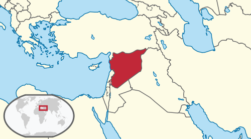
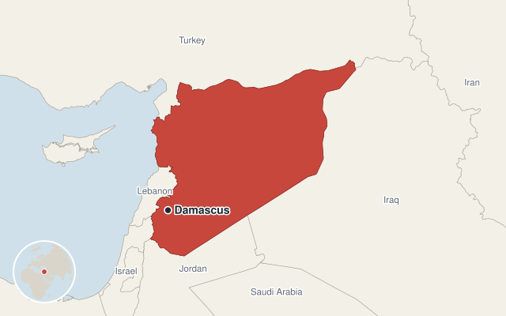

---
id    = "6cb521fd-cef0-5cbf-91a5-5a93cb1f6a0e"
model = "Basic"
tags  = ["asia", "mediterranean", "middle_east", "sovereign_state", "map"]
---

## Front

What is highlighted on this map?

## Back

<b>Syria</b>

## Extra

Borders Turkey, Iraq, Jordan, Israel and Lebanon Area of 185,180 km²

Borders the Mediterranean Sea to the west. Its highest point is Mount Hermon.

<a href="https://en.wikipedia.org/wiki/Syria">Syria on Wikipedia</a>
