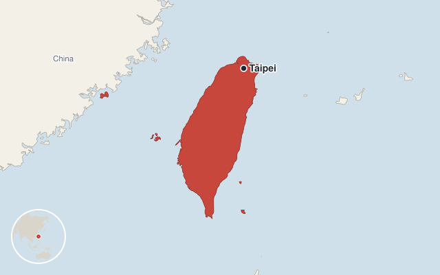
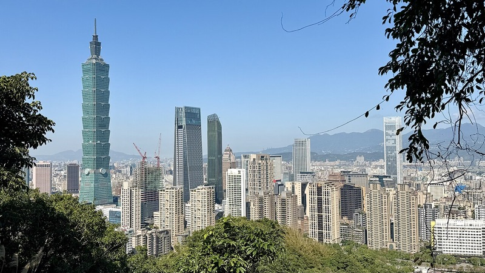

---
id    = "5dbf0210-8ad6-5dfa-8ae3-2cc84d8b01e9"
model = "Basic"
tags  = ["asia", "sovereign_state", "capital"]
---

## Front

What is the capital of <b>Taiwan</b>?

## Back

<b>Taipei</b>

## Extra

<i>Photo: Heeheemalu, CC BY-SA 4.0, via Wikimedia Commons</i>

About 2.43 million people (2026) About 25 km southwest of the port city of Keelung

Most of the city rests on the Taipei Basin, an ancient lakebed. The Keelung and Xindian rivers join to form the Tamsui River along its western border.

Partially recognised state claimed by China.

<a href="https://en.wikipedia.org/wiki/Taipei">Taipei on Wikipedia</a> <a href="https://en.wikipedia.org/wiki/Taiwan">Taiwan on Wikipedia</a>
