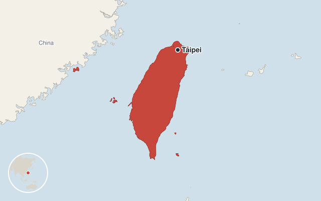

---
id    = "009d24b4-16c5-549f-96da-f5eb0a12d670"
model = "Basic"
tags  = ["asia", "sovereign_state", "country"]
---

## Front

<b>Taipei</b> is the capital of which country or territory?

## Back

<b>Taiwan</b>

## Extra

<i>Photo: xiangyang17, CC BY-SA 2.0, via Wikimedia Commons</i>

About 23.3 million people (2026) Among the most densely populated countries

The island has been settled for at least 25,000 years. Ancestors of Taiwanese indigenous peoples settled it around 6,000 years ago.

Partially recognised state claimed by China.

<a href="https://en.wikipedia.org/wiki/Taiwan">Taiwan on Wikipedia</a> <a href="https://en.wikipedia.org/wiki/Taipei">Taipei on Wikipedia</a>
