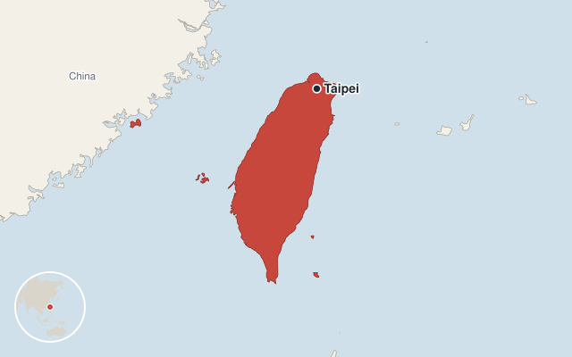

---
id    = "26e9e156-b954-54ed-970b-65e179b40d37"
model = "Basic"
tags  = ["asia", "sovereign_state", "flag"]
---

## Front

Whose flag is this?

## Back

<b>Taiwan</b>

## Extra

Made the official national flag of the Republic of China in 1928

A red field with a blue canton bearing a white disk ringed by twelve triangles, for the sun and its rays. Designed in 1895; Sun Yat-sen added the red field in 1906.

Partially recognised state claimed by China.

<a href="https://en.wikipedia.org/wiki/Flag_of_the_Republic_of_China">Flag of the Republic of China on Wikipedia</a> <a href="https://en.wikipedia.org/wiki/Taiwan">Taiwan on Wikipedia</a>
