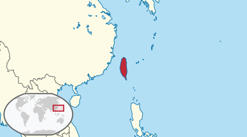
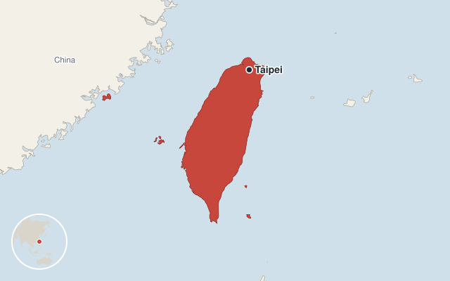

---
id    = "a9ae7e62-78e9-5d99-ab1a-71cada7851de"
model = "Basic"
tags  = ["asia", "sovereign_state", "map"]
---

## Front

What is highlighted on this map?

## Back

<b>Taiwan</b>

## Extra

Main island of 35,808 km² Highest point: Yushan Main Peak

The main island, formerly known as Formosa, lies between the East and South China Seas. Mountain ranges dominate the eastern two-thirds and plains the western third.

Partially recognised state claimed by China.

<a href="https://en.wikipedia.org/wiki/Taiwan">Taiwan on Wikipedia</a>
