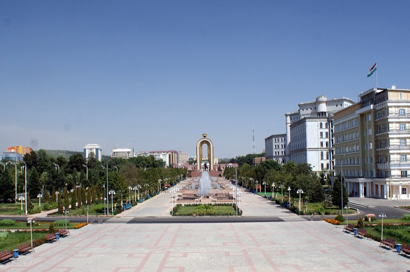

---
id    = "a88851ce-efd9-5b6f-8f94-83aab6dd2464"
model = "Basic"
tags  = ["asia", "sovereign_state", "capital"]
---

## Front

What is the capital of <b>Tajikistan</b>?

## Back

<b>Dushanbe</b>

## Extra

<i>Photo: Kondephy, CC BY-SA 4.0, via Wikimedia Commons</i>

About 1.2 million people (2022) In the Hisar Valley, at 750 to 930 m

Known in Russian as Dyushambe until 1929, then as Stalinabad, after Joseph Stalin, until 1961.

<a href="https://en.wikipedia.org/wiki/Dushanbe">Dushanbe on Wikipedia</a> <a href="https://en.wikipedia.org/wiki/Tajikistan">Tajikistan on Wikipedia</a>
