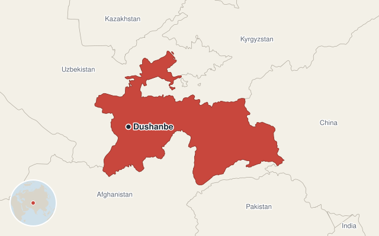

---
id    = "3eb250f0-acf1-52d8-99af-91f9bb3f5f5e"
model = "Basic"
tags  = ["asia", "sovereign_state", "country"]
---

## Front

<b>Dushanbe</b> is the capital of which country or territory?

## Back

<b>Tajikistan</b>

## Extra

About 9.5 million people (2021) Landlocked, in Central Asia

Early cultures include the Oxus civilisation in the west. Parts of the country were ruled by the Achaemenids, Alexander the Great and the Samanid Empire.

<a href="https://en.wikipedia.org/wiki/Tajikistan">Tajikistan on Wikipedia</a> <a href="https://en.wikipedia.org/wiki/Dushanbe">Dushanbe on Wikipedia</a>
