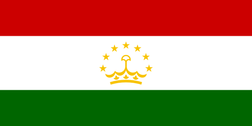
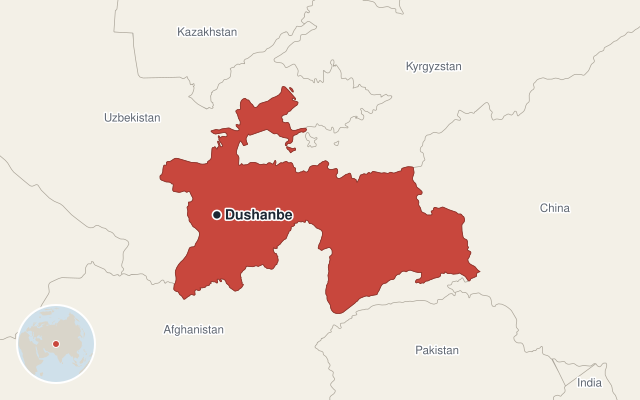

---
id    = "974c9878-d30e-5555-bd98-fc426127bebd"
model = "Basic"
tags  = ["asia", "sovereign_state", "flag"]
---

## Front

Whose flag is this?

## Back

<b>Tajikistan</b>

## Extra

Adopted in November 1992

An unequal tricolour of red, white and green in a 2:3:2 ratio, with a yellow crown under an arc of seven stars. The colours were kept from the Tajik Soviet flag.

<a href="https://en.wikipedia.org/wiki/Flag_of_Tajikistan">Flag of Tajikistan on Wikipedia</a> <a href="https://en.wikipedia.org/wiki/Tajikistan">Tajikistan on Wikipedia</a>
