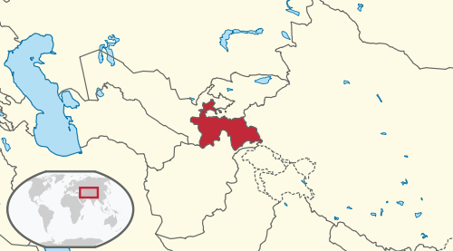
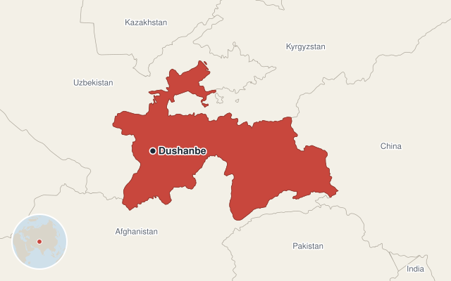

---
id    = "b72fd619-2066-5926-83b4-6eb5a17b3314"
model = "Basic"
tags  = ["asia", "sovereign_state", "map"]
---

## Front

What is highlighted on this map?

## Back

<b>Tajikistan</b>

## Extra

Borders Afghanistan, Uzbekistan, Kyrgyzstan and China Area of about 143,100 km²

Narrowly separated from Pakistan by Afghanistan's Wakhan Corridor. Its highest point is Ismoil Somoni Peak.

<a href="https://en.wikipedia.org/wiki/Tajikistan">Tajikistan on Wikipedia</a>
