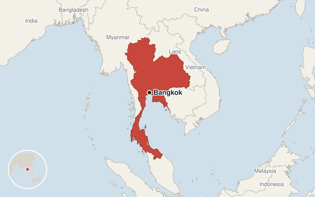
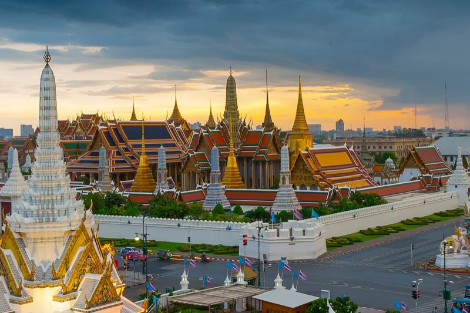

---
id    = "a81933c3-080b-5dc5-9fd1-b74636ac7ade"
model = "Basic"
tags  = ["asia", "southeast_asia", "sovereign_state", "capital"]
---

## Front

What is the capital of <b>Thailand</b>?

## Back

<b>Bangkok</b>

## Extra

<i>Photo: Preecha.MJ, CC BY-SA 4.0, via Wikimedia Commons</i>

About 9.1 million people (2024) In the Chao Phraya River delta in central Thailand

Traces its roots to a small trading post of the Ayutthaya era in the 15th century. It later became the site of two capitals: Thonburi in 1767 and Rattanakosin in 1782.

<a href="https://en.wikipedia.org/wiki/Bangkok">Bangkok on Wikipedia</a> <a href="https://en.wikipedia.org/wiki/Thailand">Thailand on Wikipedia</a>
