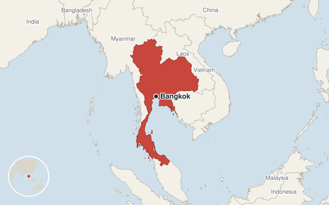

---
id    = "c00fa9a2-12e7-548c-8611-58430bc93b3a"
model = "Basic"
tags  = ["asia", "southeast_asia", "sovereign_state", "country"]
---

## Front

<b>Bangkok</b> is the capital of which country or territory?

## Back

<b>Thailand</b>

## Extra

About 66 million people (2017) Formerly known as Siam

The Tai people began migrating into the territory between the 8th and 10th centuries. Kingdoms such as Sukhothai, Lan Na and Ayutthaya were established in the classical period.

<a href="https://en.wikipedia.org/wiki/Thailand">Thailand on Wikipedia</a> <a href="https://en.wikipedia.org/wiki/Bangkok">Bangkok on Wikipedia</a>
