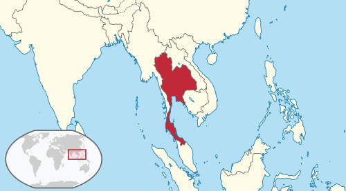
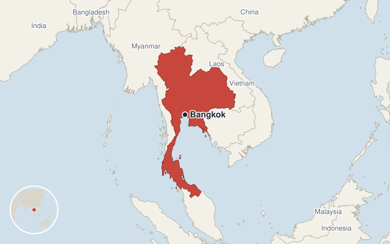
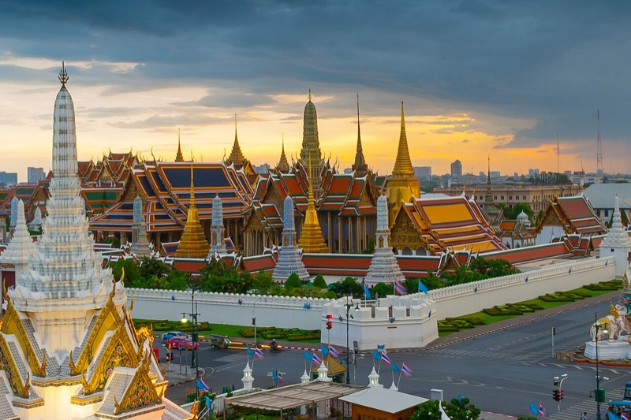

---
id    = "77fbbb1e-3db1-5028-882d-a663ad2c5ba7"
model = "Basic"
tags  = ["asia", "southeast_asia", "sovereign_state", "map"]
---

## Front

What is highlighted on this map?

## Back

<b>Thailand</b>

## Extra

<i>Photo: Preecha.MJ, CC BY-SA 4.0, via Wikimedia Commons</i>

Borders Myanmar, Laos, Cambodia and Malaysia Area of about 513,000 km²

Its coasts lie on the Gulf of Thailand and the Andaman Sea. The highest point is Doi Inthanon.

<a href="https://en.wikipedia.org/wiki/Thailand">Thailand on Wikipedia</a>
