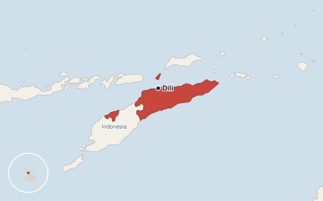
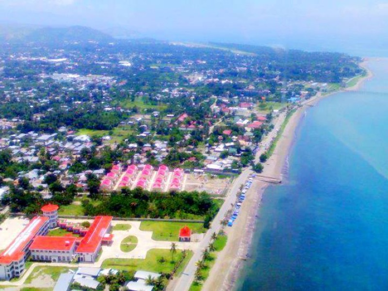

---
id    = "589946ea-22e9-5090-8d30-be6f50f0a8b3"
model = "Basic"
tags  = ["asia", "southeast_asia", "sovereign_state", "capital"]
---

## Front

What is the capital of <b>Timor-Leste</b>?

## Back

<b>Dili</b>

## Extra

<i>Photo: José Fernando Real, Jose Fernando Real, via Wikimedia Commons</i>

About 222,000 people (2015) 11 m up on the north coast, on flat land hemmed in by mountains

Capital of Portuguese Timor since 1769, it has served as the chief port and economic hub of what is now Timor-Leste ever since.

Also known as East Timor.

<a href="https://en.wikipedia.org/wiki/Dili">Dili on Wikipedia</a> <a href="https://en.wikipedia.org/wiki/Timor-Leste">Timor-Leste on Wikipedia</a>
