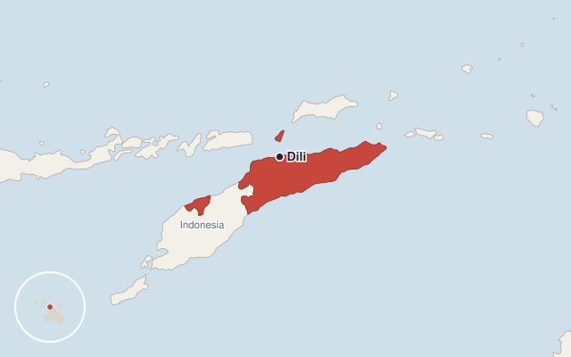
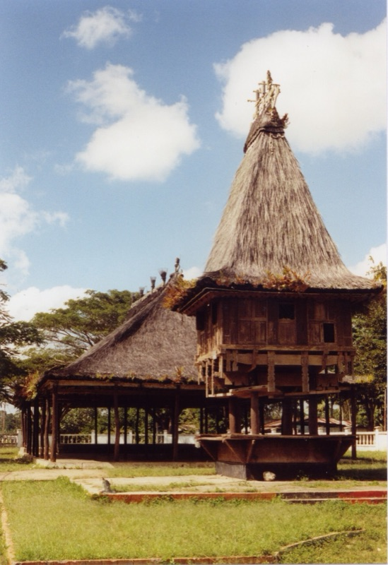

---
id    = "78e474e0-cc28-5ccc-bdd8-3614f436cb99"
model = "Basic"
tags  = ["asia", "southeast_asia", "sovereign_state", "country"]
---

## Front

<b>Dili</b> is the capital of which country or territory?

## Back

<b>Timor-Leste</b>

## Extra

<i>Photo: J. Patrick Fischer, CC BY 2.5, via Wikimedia Commons</i>

About 1.4 million people (2024) Declared independence in 1975

Under Portuguese influence from the sixteenth century and a colony until 1975, when a declaration of independence was followed by an Indonesian invasion and annexation.

Also known as East Timor.

<a href="https://en.wikipedia.org/wiki/Timor-Leste">Timor-Leste on Wikipedia</a> <a href="https://en.wikipedia.org/wiki/Dili">Dili on Wikipedia</a>
