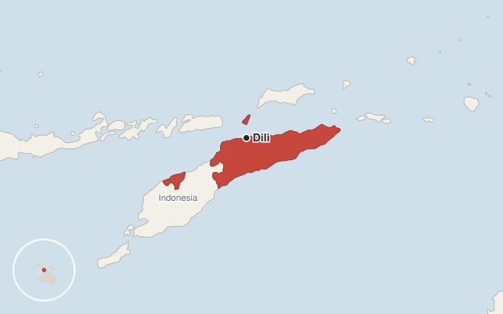

---
id    = "3e508be9-3199-57c9-85b7-c04eb7b58a1f"
model = "Basic"
tags  = ["asia", "southeast_asia", "sovereign_state", "flag"]
---

## Front

Whose flag is this?

## Back

<b>Timor-Leste</b>

## Extra

Defined in Section 15 of the constitution

The white star in the black triangle means the light that guides.

Also known as East Timor.

<a href="https://en.wikipedia.org/wiki/Flag_of_Timor-Leste">Flag of Timor-Leste on Wikipedia</a> <a href="https://en.wikipedia.org/wiki/Timor-Leste">Timor-Leste on Wikipedia</a>
