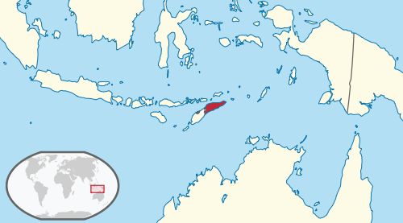

---
id    = "3ca9f534-1ff2-572d-bd5d-e992b91e6dc4"
model = "Basic"
tags  = ["asia", "southeast_asia", "sovereign_state", "map"]
---

## Front

What is highlighted on this map?

## Back

<b>Timor-Leste</b>

## Extra

Also known as East Timor.
