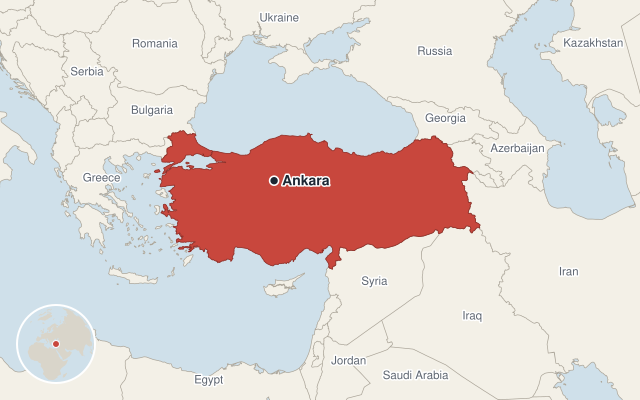

---
id    = "cc3356f6-ff04-5bcf-a2b2-7e1bd44c8c46"
model = "Basic"
tags  = ["asia", "mediterranean", "middle_east", "sovereign_state", "capital"]
---

## Front

What is the capital of <b>Turkey</b>?

## Back

<b>Ankara</b>

## Extra

Also known as Türkiye.

<a href="https://en.wikipedia.org/wiki/Ankara">Ankara on Wikipedia</a> <a href="https://en.wikipedia.org/wiki/Turkey">Turkey on Wikipedia</a>
