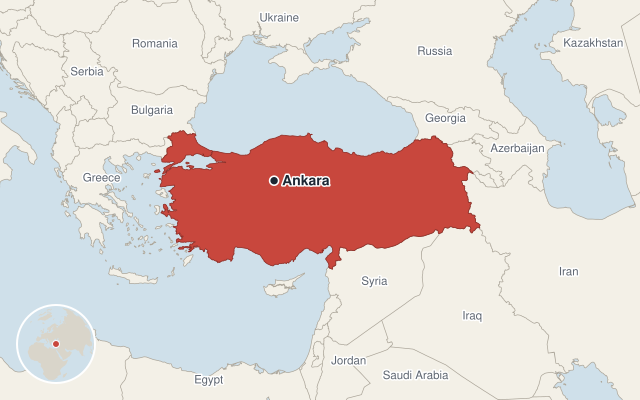

---
id    = "f2bf29b9-f4de-5418-a634-3f02854253ad"
model = "Basic"
tags  = ["asia", "mediterranean", "middle_east", "sovereign_state", "country"]
---

## Front

<b>Ankara</b> is the capital of which country or territory?

## Back

<b>Turkey</b>

## Extra

Also known as Türkiye.

<a href="https://en.wikipedia.org/wiki/Turkey">Turkey on Wikipedia</a> <a href="https://en.wikipedia.org/wiki/Ankara">Ankara on Wikipedia</a>
