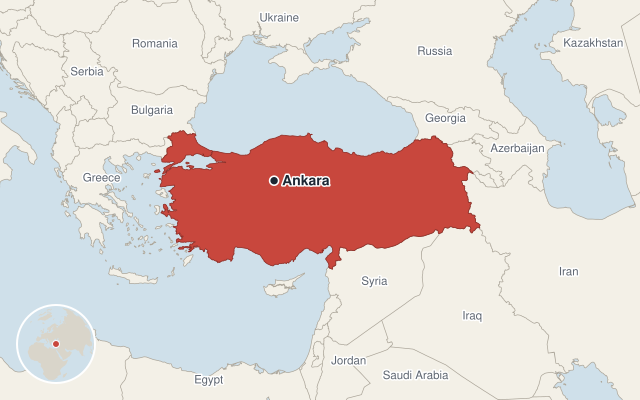

---
id    = "06985901-decf-5fff-aa3e-89297555ae7b"
model = "Basic"
tags  = ["asia", "mediterranean", "middle_east", "sovereign_state", "flag"]
---

## Front

Whose flag is this?

## Back

<b>Turkey</b>

## Extra

Legally standardized by the Turkish Flag Law on 29 May 1936

A white crescent and star on red, based on the 18th-century flag of the Ottoman Empire. It is often called "the red flag" (al bayrak).

Also known as Türkiye.

<a href="https://en.wikipedia.org/wiki/Flag_of_Turkey">Flag of Turkey on Wikipedia</a> <a href="https://en.wikipedia.org/wiki/Turkey">Turkey on Wikipedia</a>
