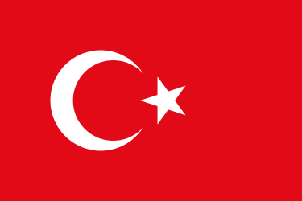

---
id    = "06985901-decf-5fff-aa3e-89297555ae7b"
model = "Basic"
tags  = ["asia", "mediterranean", "middle_east", "sovereign_state", "flag"]
---

## Front

Whose flag is this?

## Back

<b>Turkey</b>

## Extra

Also known as Türkiye.
