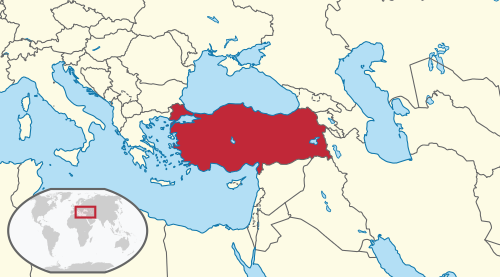
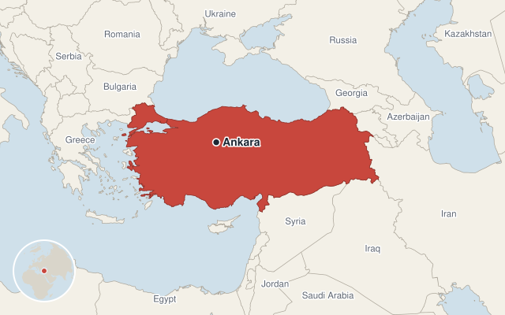

---
id    = "2b44f0b5-1f27-5492-a083-7ab00a3cd6fd"
model = "Basic"
tags  = ["asia", "mediterranean", "middle_east", "sovereign_state", "map"]
---

## Front

What is highlighted on this map?

## Back

<b>Turkey</b>

## Extra

Borders Georgia, Armenia, Azerbaijan, Iran, Iraq, Syria, Greece and Bulgaria Highest point: Mount Ararat

The Black Sea lies to the north, the Mediterranean Sea to the south and the Aegean Sea to the west. A smaller part, East Thrace, sits in Southeast Europe.

Also known as Türkiye.

<a href="https://en.wikipedia.org/wiki/Turkey">Turkey on Wikipedia</a>
