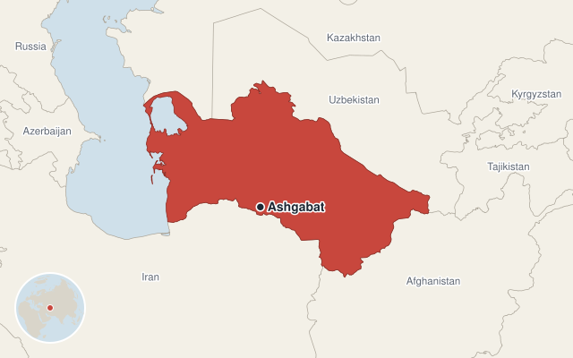

---
id    = "280bd497-984b-5751-bea0-44485cff5558"
model = "Basic"
tags  = ["asia", "sovereign_state", "capital"]
---

## Front

What is the capital of <b>Turkmenistan</b>?

## Back

<b>Ashgabat</b>

## Extra

<a href="https://en.wikipedia.org/wiki/Ashgabat">Ashgabat on Wikipedia</a> <a href="https://en.wikipedia.org/wiki/Turkmenistan">Turkmenistan on Wikipedia</a>
