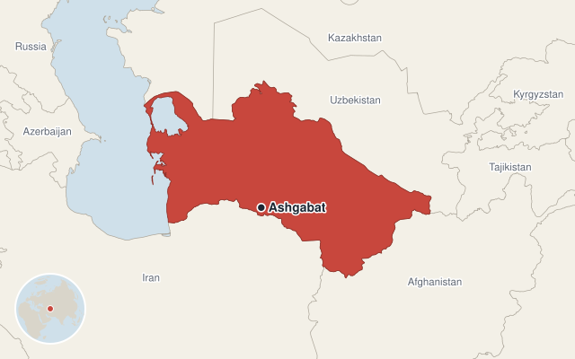

---
id    = "dd5c3719-529b-5bee-8c07-a36bd5b95a65"
model = "Basic"
tags  = ["asia", "sovereign_state", "country"]
---

## Front

<b>Ashgabat</b> is the capital of which country or territory?

## Back

<b>Turkmenistan</b>

## Extra

About 6.1 million people (2021) Lowest population of the Central Asian republics

Merv, one of the oldest oasis-cities in Central Asia, was once among the biggest cities in the world and an important stop on the Silk Road.

<a href="https://en.wikipedia.org/wiki/Turkmenistan">Turkmenistan on Wikipedia</a> <a href="https://en.wikipedia.org/wiki/Ashgabat">Ashgabat on Wikipedia</a>
