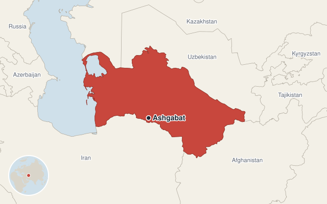

---
id    = "c08930b8-2653-5d36-9b76-1e11e95e7758"
model = "Basic"
tags  = ["asia", "sovereign_state", "flag"]
---

## Front

Whose flag is this?

## Back

<b>Turkmenistan</b>

## Extra

Introduced on 27 September 1992; the 2:3 version was adopted on 24 January 2001

A white crescent and five stars stand for the five regions of the country and the Five Pillars of Islam. The red stripe at the hoist carries five carpet guls, designs used in rugs.

<a href="https://en.wikipedia.org/wiki/Flag_of_Turkmenistan">Flag of Turkmenistan on Wikipedia</a> <a href="https://en.wikipedia.org/wiki/Turkmenistan">Turkmenistan on Wikipedia</a>
