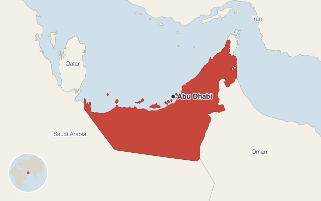

---
id    = "53cb8611-440d-55be-af85-fe8d5cbab050"
model = "Basic"
tags  = ["asia", "middle_east", "sovereign_state", "capital"]
---

## Front

What is the capital of <b>United Arab Emirates</b>?

## Back

<b>Abu Dhabi</b>

## Extra

About 1.57 million people (2023) On a T-shaped island extending into the Persian Gulf

The second-most populous city after Dubai. The Abu Dhabi Investment Authority, based here, is estimated to manage about US$1 trillion, the world's third-largest sovereign wealth fund.

<a href="https://en.wikipedia.org/wiki/Abu_Dhabi">Abu Dhabi on Wikipedia</a> <a href="https://en.wikipedia.org/wiki/United_Arab_Emirates">United Arab Emirates on Wikipedia</a>
