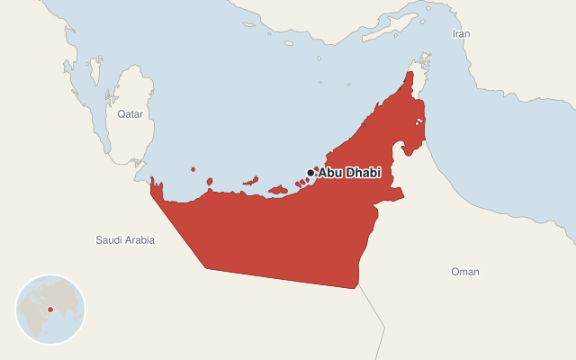

---
id    = "0cfcc836-e9ef-59aa-8ea1-f73f2da56079"
model = "Basic"
tags  = ["asia", "middle_east", "sovereign_state", "country"]
---

## Front

<b>Abu Dhabi</b> is the capital of which country or territory?

## Back

<b>United Arab Emirates</b>

## Extra

Federation of seven emirates About 10.1 million people (2026)

Dubai is the largest city, but Abu Dhabi is the capital. Arabic is the official language, while English is the most spoken and the language of business.

<a href="https://en.wikipedia.org/wiki/United_Arab_Emirates">United Arab Emirates on Wikipedia</a> <a href="https://en.wikipedia.org/wiki/Abu_Dhabi">Abu Dhabi on Wikipedia</a>
