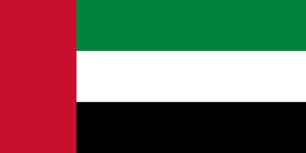
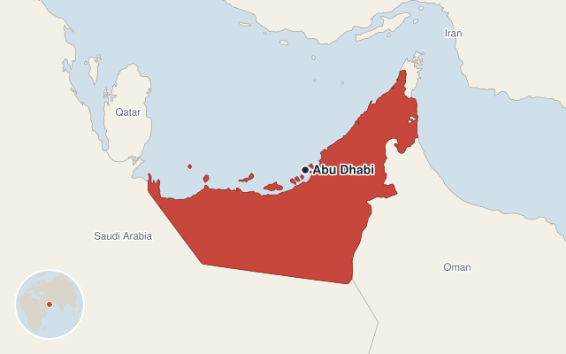

---
id    = "970e1a88-af13-5d17-8eba-89b963239c3a"
model = "Basic"
tags  = ["asia", "middle_east", "sovereign_state", "flag"]
---

## Front

Whose flag is this?

## Back

<b>United Arab Emirates</b>

## Extra

Adopted on 2 December 1971

Designed by Abdullah Mohammed Al Maainah, then 19, who won a nationwide design contest. Red, green, white and black are the pan-Arab colours, standing for the sovereignty and unity of the Arab states.

<a href="https://en.wikipedia.org/wiki/Flag_of_the_United_Arab_Emirates">Flag of the United Arab Emirates on Wikipedia</a> <a href="https://en.wikipedia.org/wiki/United_Arab_Emirates">United Arab Emirates on Wikipedia</a>
