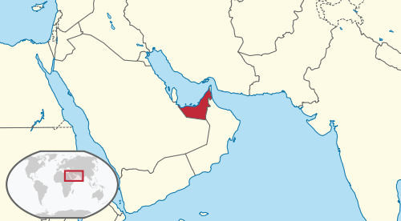
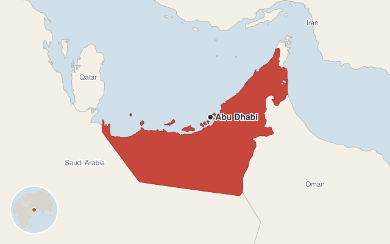
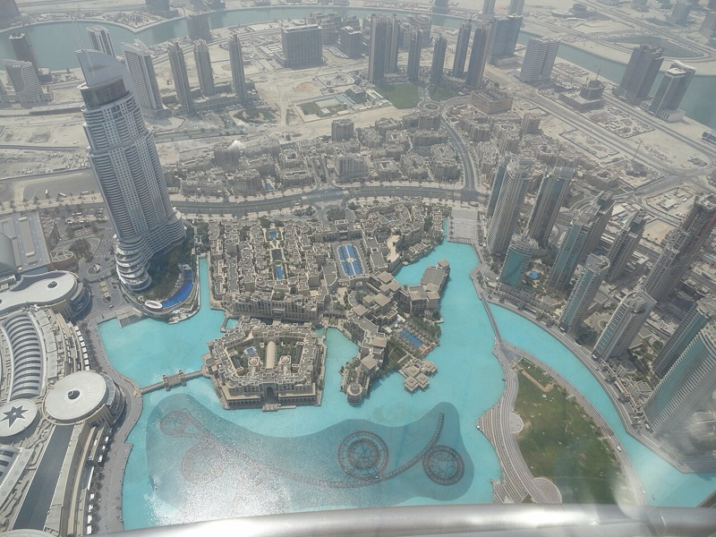

---
id    = "869041fb-f69f-53f9-9c9f-3969a388caf7"
model = "Basic"
tags  = ["asia", "middle_east", "sovereign_state", "map"]
---

## Front

What is highlighted on this map?

## Back

<b>United Arab Emirates</b>

## Extra

<i>Photo: Fabio Achilli from Milano, Italy, CC BY 2.0, via Wikimedia Commons</i>

Borders Oman and Saudi Arabia Area of about 83,600 km²

Sits at the eastern end of the Arabian Peninsula, with the Persian Gulf to the north and west and the Gulf of Oman to the east. Highest point: Jebel Jais.

<a href="https://en.wikipedia.org/wiki/United_Arab_Emirates">United Arab Emirates on Wikipedia</a>
