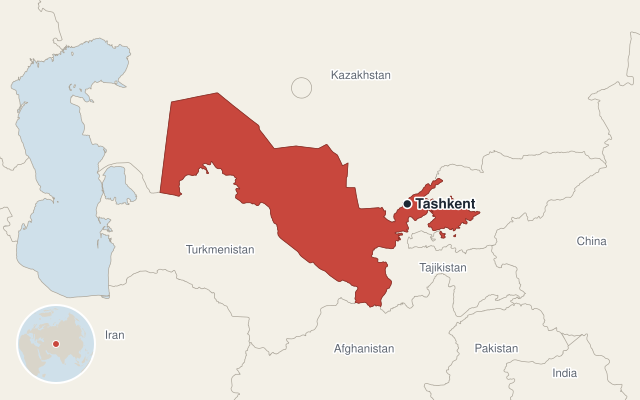

---
id    = "90a1bb90-1549-52b5-8458-09d787e2a8ec"
model = "Basic"
tags  = ["asia", "sovereign_state", "capital"]
---

## Front

What is the capital of <b>Uzbekistan</b>?

## Back

<b>Tashkent</b>

## Extra

<a href="https://en.wikipedia.org/wiki/Tashkent">Tashkent on Wikipedia</a> <a href="https://en.wikipedia.org/wiki/Uzbekistan">Uzbekistan on Wikipedia</a>
