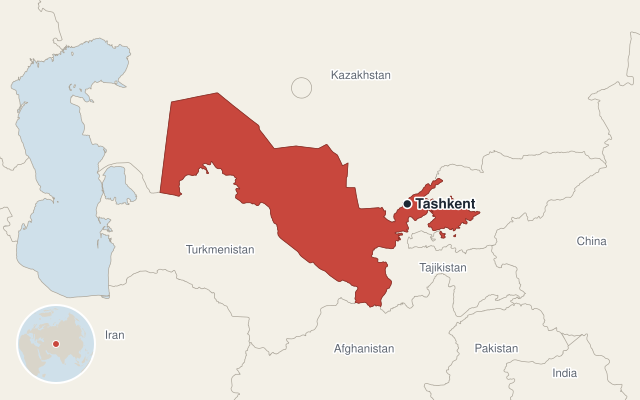

---
id    = "6f59e95a-1935-5dad-a642-4e79a5def55a"
model = "Basic"
tags  = ["asia", "sovereign_state", "country"]
---

## Front

<b>Tashkent</b> is the capital of which country or territory?

## Back

<b>Uzbekistan</b>

## Extra

About 35 million people (2021) Most populous country in Central Asia

The first recorded settlers were Eastern Iranian nomads, known as Scythians, who founded kingdoms in Khwarazm, Sogdiana and Bactria in the 8th to 6th centuries BC.

<a href="https://en.wikipedia.org/wiki/Uzbekistan">Uzbekistan on Wikipedia</a> <a href="https://en.wikipedia.org/wiki/Tashkent">Tashkent on Wikipedia</a>
