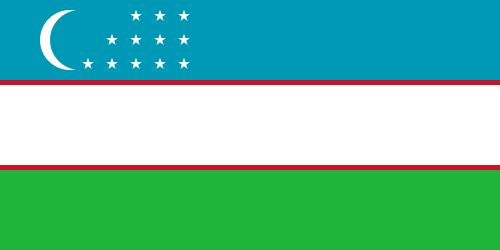
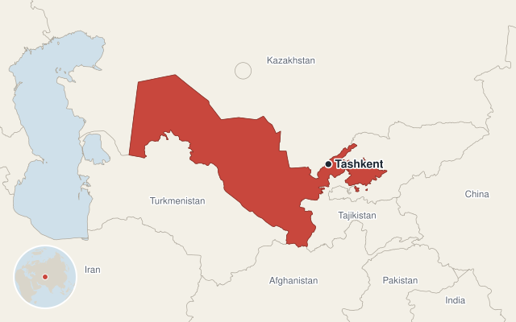

---
id    = "c3fb45b8-4b0d-5b85-a074-8a32a535fcf3"
model = "Basic"
tags  = ["asia", "sovereign_state", "flag"]
---

## Front

Whose flag is this?

## Back

<b>Uzbekistan</b>

## Extra

Adopted in 1991, replacing the Uzbek Soviet flag

No symbolism is officially designated. Common readings: azure for sky and clear water, white for peace and good luck, green for nature and harvest, and the red lines for the power of life.

<a href="https://en.wikipedia.org/wiki/Flag_of_Uzbekistan">Flag of Uzbekistan on Wikipedia</a> <a href="https://en.wikipedia.org/wiki/Uzbekistan">Uzbekistan on Wikipedia</a>
