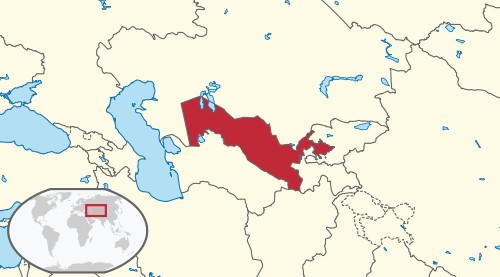
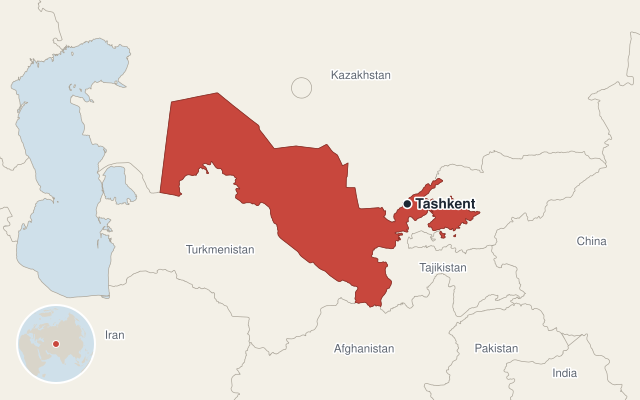

---
id    = "b5c66b61-9324-5b39-9159-f932babdc4f7"
model = "Basic"
tags  = ["asia", "sovereign_state", "map"]
---

## Front

What is highlighted on this map?

## Back

<b>Uzbekistan</b>

## Extra

<a href="https://en.wikipedia.org/wiki/Uzbekistan">Uzbekistan on Wikipedia</a>
