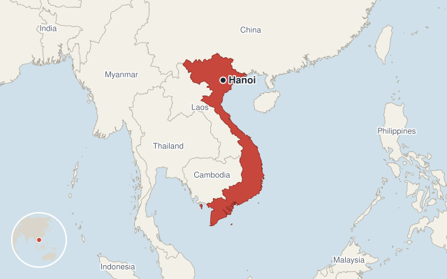

---
id    = "744ad7e0-2ec3-57c7-aa66-67d348a61a67"
model = "Basic"
tags  = ["asia", "southeast_asia", "sovereign_state", "capital"]
---

## Front

What is the capital of <b>Vietnam</b>?

## Back

<b>Hanoi</b>

## Extra

<a href="https://en.wikipedia.org/wiki/Hanoi">Hanoi on Wikipedia</a> <a href="https://en.wikipedia.org/wiki/Vietnam">Vietnam on Wikipedia</a>
