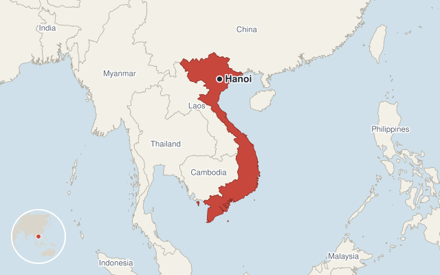

---
id    = "ffabb5ba-35bc-57cc-ae32-5c6ef69ff878"
model = "Basic"
tags  = ["asia", "southeast_asia", "sovereign_state", "country"]
---

## Front

<b>Hanoi</b> is the capital of which country or territory?

## Back

<b>Vietnam</b>

## Extra

About 96 million people (2019) Current state dates from 1976

Northern and central Vietnam were under Chinese rule from 111 BC until the first dynasty emerged in 939.

<a href="https://en.wikipedia.org/wiki/Vietnam">Vietnam on Wikipedia</a> <a href="https://en.wikipedia.org/wiki/Hanoi">Hanoi on Wikipedia</a>
