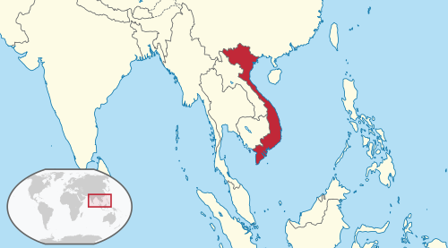
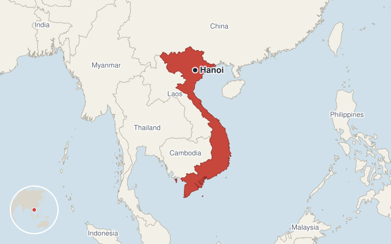
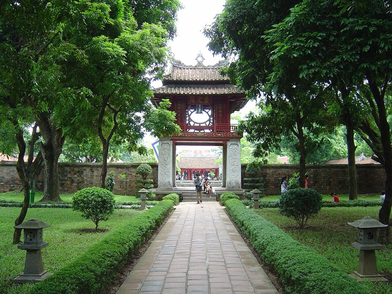

---
id    = "9d710ae5-db37-5b40-a9bb-5ecd9e741f31"
model = "Basic"
tags  = ["asia", "southeast_asia", "sovereign_state", "map"]
---

## Front

What is highlighted on this map?

## Back

<b>Vietnam</b>

## Extra

<i>Photo: The original uploader was Chuoibk at English Wikipedia., CC BY-SA 3.0, via Wikimedia Commons</i>

Borders China, Laos and Cambodia Area of about 331,000 km²

At the eastern edge of mainland Southeast Asia, along the South China Sea to the east and the Gulf of Thailand to the southwest. Highest point: Fansipan.

<a href="https://en.wikipedia.org/wiki/Vietnam">Vietnam on Wikipedia</a>
