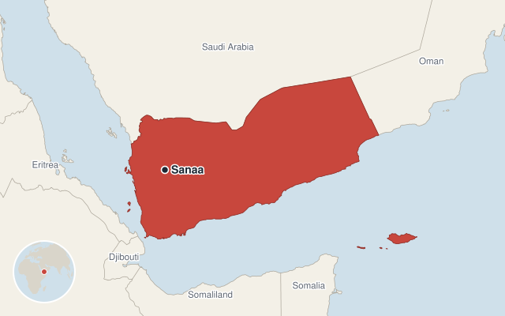

---
id    = "fbd7b3dc-a5f1-5025-b1ab-dc2ea24b4b3e"
model = "Basic"
tags  = ["asia", "middle_east", "sovereign_state", "capital"]
---

## Front

What is the capital of <b>Yemen</b>?

## Back

<b>Sanaa</b>

## Extra

Also spelled as Sana'a.

<a href="https://en.wikipedia.org/wiki/Sanaa">Sanaa on Wikipedia</a> <a href="https://en.wikipedia.org/wiki/Yemen">Yemen on Wikipedia</a>
