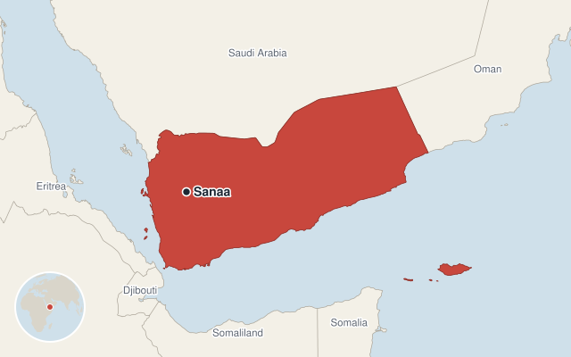

---
id    = "d95bac8d-8610-5ad2-bc21-b68bc13251aa"
model = "Basic"
tags  = ["asia", "middle_east", "sovereign_state", "country"]
---

## Front

<b>Sanaa</b> is the capital of which country or territory?

## Back

<b>Yemen</b>

## Extra

About 34 million people (2026) Second-largest country on the Arabian Peninsula by area and population

Yemen has been at the crossroads of many civilisations for over 7,000 years. The Sabaeans formed a thriving commercial kingdom there.

Also spelled as Sana'a.

<a href="https://en.wikipedia.org/wiki/Yemen">Yemen on Wikipedia</a> <a href="https://en.wikipedia.org/wiki/Sanaa">Sanaa on Wikipedia</a>
