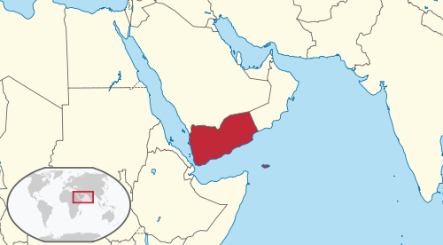

---
id    = "70184f5e-334a-5f8a-a4c7-81f0eaf6e2de"
model = "Basic"
tags  = ["asia", "middle_east", "sovereign_state", "map"]
---

## Front

What is highlighted on this map?

## Back

<b>Yemen</b>

## Extra

<a href="https://en.wikipedia.org/wiki/Yemen">Yemen on Wikipedia</a>
