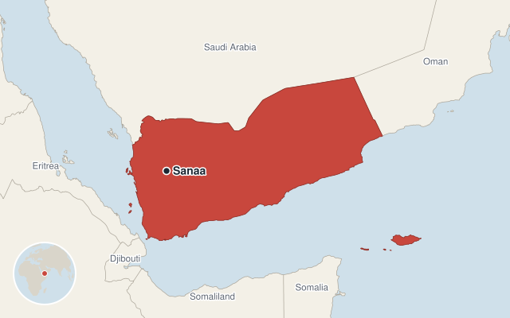
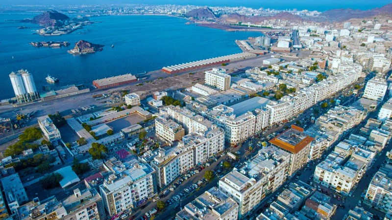

---
id    = "70184f5e-334a-5f8a-a4c7-81f0eaf6e2de"
model = "Basic"
tags  = ["asia", "middle_east", "sovereign_state", "map"]
---

## Front

What is highlighted on this map?

## Back

<b>Yemen</b>

## Extra

<i>Photo: Ahmedxalkatheri, CC BY-SA 4.0, via Wikimedia Commons</i>

Borders Saudi Arabia and Oman Area of 455,503 km², with about 2,000 km of coast

Includes the Socotra Archipelago. The Red Sea lies to the west, the Gulf of Aden to the south and the Arabian Sea to the east.

<a href="https://en.wikipedia.org/wiki/Yemen">Yemen on Wikipedia</a>
