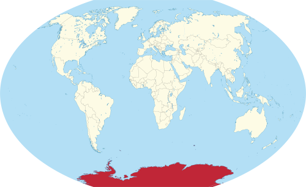

---
id    = "75a801a6-ac34-54c8-b4e4-bb57dacc9ad4"
model = "Basic"
tags  = ["continents", "map"]
---

## Front

What is highlighted on this map?

## Back

<b>Antarctica</b>

## Extra

About 14.2 million km², the fifth-largest continent Surrounded by the Southern Ocean, with the geographic South Pole

The coldest, driest and windiest continent on average, with the highest average elevation. Most of it lies under an ice sheet averaging 1.9 km thick.

<a href="https://en.wikipedia.org/wiki/Antarctica">Antarctica on Wikipedia</a>
