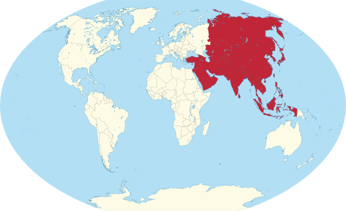

---
id    = "ea7b1fc6-995b-553c-900c-63dd76160070"
model = "Basic"
tags  = ["continents", "map"]
---

## Front

What is highlighted on this map?

## Back

<b>Asia</b>

## Extra

<a href="https://en.wikipedia.org/wiki/Asia">Asia on Wikipedia</a>
