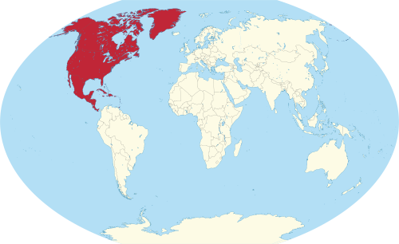

---
id    = "c0752b4a-84db-5742-b5b2-39f4cd416e52"
model = "Basic"
tags  = ["continents", "map"]
---

## Front

What is highlighted on this map?

## Back

<b>North America</b>

## Extra

<a href="https://en.wikipedia.org/wiki/North_America">North America on Wikipedia</a>
