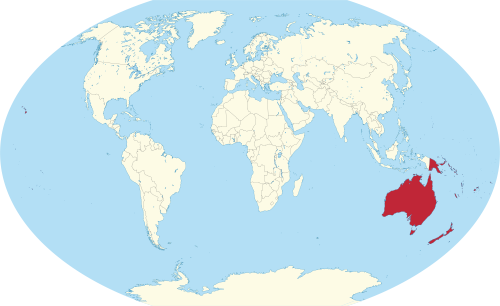

---
id    = "93113b94-e53c-5bdd-99b4-d3c2d62b1f69"
model = "Basic"
tags  = ["continents", "map"]
---

## Front

What is highlighted on this map?

## Back

<b>Oceania</b>

## Extra

World region covering the Australian continent and most of the islands in the Pacific Ocean.

<a href="https://en.wikipedia.org/wiki/Oceania">Oceania on Wikipedia</a>
