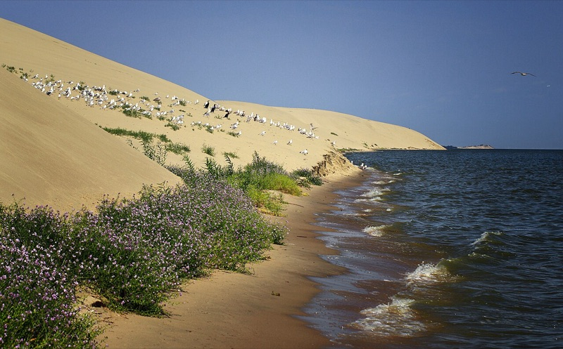

---
id    = "30ef3de2-3e61-5f8d-a368-3021e1a7c05b"
model = "Basic"
tags  = ["europe", "sovereign_state", "country"]
---

## Front

<b>Sukhumi</b> is the capital of which country or territory?

## Back

<b>Abkhazia</b>

## Extra

<i>Photo: Vacheraindeli, CC BY-SA 4.0, via Wikimedia Commons</i>

About 244,000 people (2025) in 8,665 km²

A partially recognised state: Russia, Venezuela, Nicaragua and Syria recognise it as independent, while most countries consider it part of Georgia.

Independent state claimed by Georgia.

<a href="https://en.wikipedia.org/wiki/Abkhazia">Abkhazia on Wikipedia</a> <a href="https://en.wikipedia.org/wiki/Sukhumi">Sukhumi on Wikipedia</a>
