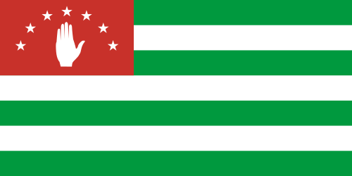

---
id    = "9101cba2-8ed1-539f-8707-03643db82bb2"
model = "Basic"
tags  = ["europe", "sovereign_state", "flag"]
---

## Front

Whose flag is this?

## Back

<b>Abkhazia</b>

## Extra

Independent state claimed by Georgia.
