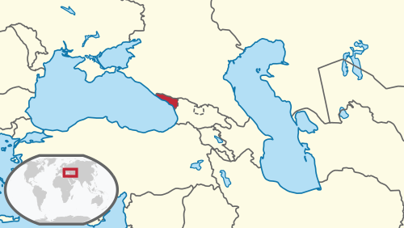

---
id    = "4bcaefc0-6ed3-5995-99cb-cec9a9b3a2d8"
model = "Basic"
tags  = ["europe", "sovereign_state", "map"]
---

## Front

What is highlighted on this map?

## Back

<b>Abkhazia</b>

## Extra

Independent state claimed by Georgia.

<a href="https://en.wikipedia.org/wiki/Abkhazia">Abkhazia on Wikipedia</a>
