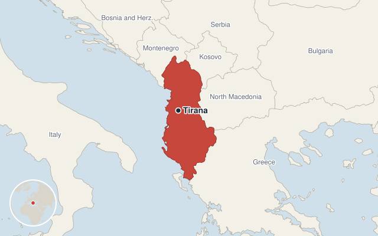

---
id    = "2f9b326c-1fb2-5eee-9392-a354a4e4cef6"
model = "Basic"
tags  = ["europe", "mediterranean", "sovereign_state", "capital"]
---

## Front

What is the capital of <b>Albania</b>?

## Back

<b>Tirana</b>

## Extra

<a href="https://en.wikipedia.org/wiki/Tirana">Tirana on Wikipedia</a> <a href="https://en.wikipedia.org/wiki/Albania">Albania on Wikipedia</a>
